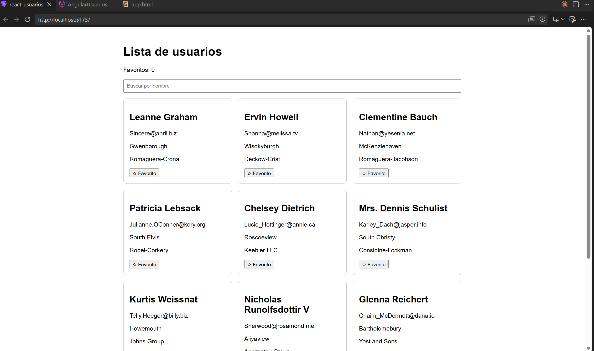
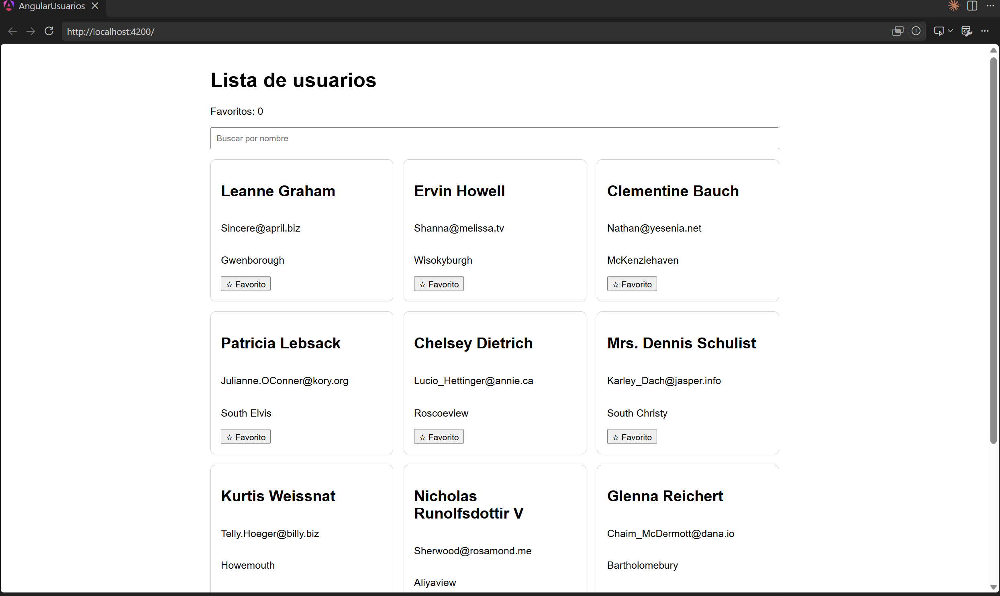

# Práctica: Directorio de usuarios en React y Angular

Hice la misma app en React y en Angular. La app trae usuarios de JSONPlaceholder, los muestra en tarjetas, tiene un buscador por nombre y un botón de favorito con contador.

## React

```bash
cd react-usuarios
npm install
npm run dev
```

Se abre en http://localhost:5173

Para la prueba:

```bash
npx vitest run
```



## Angular

```bash
cd angular-usuarios
npm install
ng serve
```

Se abre en http://localhost:4200

Para la prueba:

```bash
ng test --watch=false
```



## Diferencias que noté

- En React el estado se maneja con `useState` y en Angular con `signal`.
- En React use `fetch` y tuve que revisar `res.ok`; en Angular `HttpClient` ya marca el error solo.
- Para avisar que se marcó un favorito, en React se pasa una función por props y en Angular se usa `output()` con `emit`.
- En Angular los estilos de cada componente van separados; en React los puse todos en un solo CSS.

## Conclusión

La verdad, React me pareció más sencillo de entender que Angular. Con pocos archivos y solo `useState` y `useEffect` ya tenía la app funcionando, y el código se lee casi como JavaScript normal.

Angular me costó un poco más al inicio, ya que hay que crear más archivos, configurar `HttpClient` en `app.config.ts`, usar TypeScript y aprender cosas como `signal`, `input()` y `output()`. Pero justamente por eso me parece mejor para proyectos grandes, porque obliga a tener todo ordenado, el modelo de datos queda definido con TypeScript y ya trae incluido lo necesario (HTTP, rutas y pruebas) sin instalar librerías aparte.

En resumen, usaría React para algo rápido o pequeño, y Angular para un sistema grande donde trabajen varias personas y se necesite una estructura más clara.